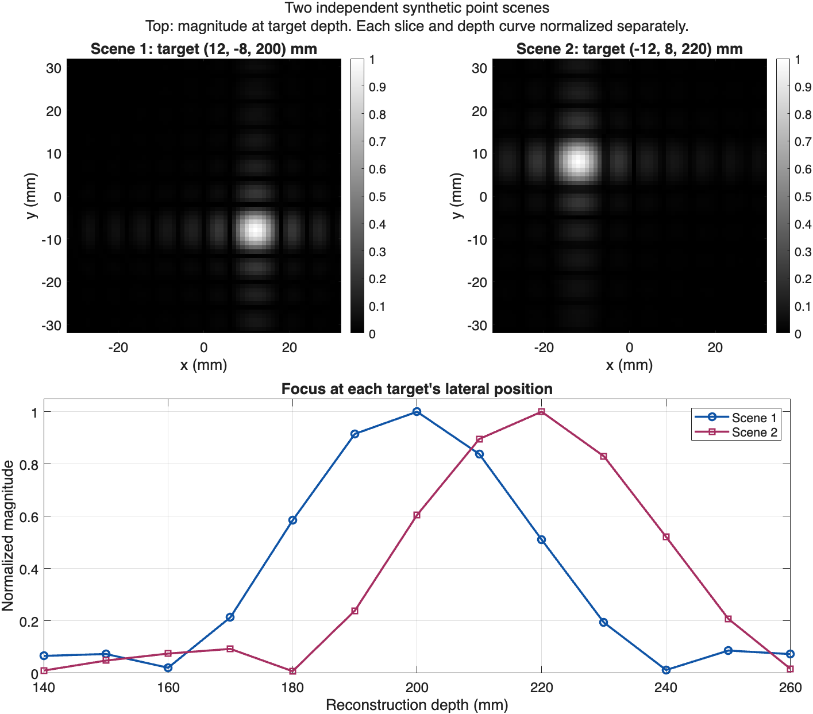

# RadarVolume

Focus calibrated radar samples into a 3D volume in MATLAB. Try two synthetic point scenes without hardware, then inspect complex outputs and physical coordinates.

## See the focus



[Open the figure at full size](docs/figures/focus.png).

Two **independent, phase-only synthetic scenes**, generated and reconstructed with the included MATLAB example. The top panels show magnitude at each target's depth; the curves show focus across depth at that target's lateral position. Each panel and curve is normalized separately. The sampled peaks land at (12, −8, 200) mm and (−12, 8, 220) mm. These are synthetic checks, not measured radar accuracy or physical-resolution estimates.

The reconstruction transforms the two aperture axes into spatial frequencies, applies a propagation phase for each requested depth, then transforms back to a complex volume. [Method and coordinate conventions](docs/reconstruction.md) · [Figure source and run record](docs/VERIFICATION.md#retained-example-figure-2026-10-23).

## Run the example

Open the repository folder in MATLAB R2026a, then run:

```matlab
addpath('examples');
outputDir = point_targets();
```

This creates a new folder under `outputs/` containing two PNG slices, `point-targets.mat`, and CSV/JSON measurements. Each image represents a separate point-target scene. Existing output paths are never overwritten. The example and checks use base MATLAB.

## Reconstruct your data

```matlab
frequency = [77e9, 60e12, 1e6, 0];
[volume, x_mm, y_mm, z_mm] = radar_volume_reconstruct( ...
    sarData, frequency, 1, 1, 140:10:260, 128);
```

The supported path uses monostatic data: each sample represents a transmitter and receiver at the same position.

Supply `sarData` as **vertical positions × horizontal positions × frequency samples**, with rows and columns in increasing physical y and x. The example values specify 1 mm aperture spacing and depths from 140 to 260 mm. All returned axes are in millimeters; `volume` retains complex amplitudes.

See [input conventions and reconstruction method](docs/reconstruction.md) for frequency units, sampling assumptions, memory limits, and the distinction from the legacy function.

## Calibration and existing scripts

`radar_volume(rawData, sensorParams, calData, delayOffset)` applies channel calibration. Its data layout is **channels × vertical positions × horizontal positions × chirp samples**. See [the calibration check](tests/smoke_test.m) for a complete synthetic input example.

The original seven-argument `reconstructSARimageFFT_3D` call retains its legacy coordinates and output. Existing array geometry, multistatic conversion, calibration files, and tutorial remain available. The high-level measured-data script needs suitable scans and additional toolbox functions such as `physconst`.

## Checks and limits

```matlab
run('tests/smoke_test.m');
run('tests/reconstruction_test.m');
```

The checks cover calibration, physical coordinate signs and units, odd/even sampling grids, depth focus, invalid inputs, and legacy compatibility. [Verification details](docs/VERIFICATION.md) record the evidence. Synthetic localization does not establish measured radar accuracy or physical resolution; the full measured MIMO pipeline has not been validated here.

## Source and license

Builds on [3D-MIMO-SAR_Imaging](https://github.com/meminyanik/3D-MIMO-SAR_Imaging/tree/60a08620929ddc35fdc3f09a54da9d77af1a2026), developed by **Muhammet Emin Yanik**, with advisor **Murat Torlak**, at The University of Texas at Dallas.

The original nine-file source snapshot matches the pinned upstream project. Eight current files remain exact; the reconstruction function adds a documented opt-in coordinate mode while preserving its original notices and default path. [Source and additions](NOTICE.md) records that distinction.

Institutional redistribution notices remain in the numerical files. [LICENSE-branding](LICENSE-branding) covers the new documentation, artwork, wrappers, and checks under MIT; it does not replace embedded source terms.
